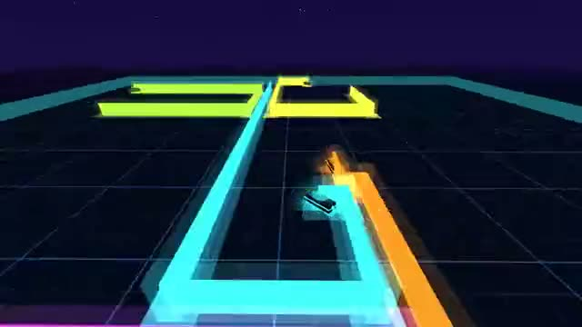

# Light Cycles

Your trail is a wall. Last rider wins. A multiplayer starter game from [Multiplayer Agent](https://multiplayeragent.com): 3D, versus, 2–6 players, with bots that fill empty seats.

## How it plays

Every rider leaves a glowing wall behind it. Turn to cut the others off. Touch any wall or the edge and you are out. The last rider still going wins the round.

**Controls:** Arrow keys or A/D to turn, or tap the left or right side of the screen.

## Make it yours in the Game Builder

Open the [Game Builder](https://multiplayeragent.com), choose **Start from a starter game** and pick Light Cycles. It opens as version 1 in your studio, ready to play and publish. Then ask for changes, for example:

- Add a jump with a cooldown
- Shrink the arena every 20 seconds
- Make it a desert at sunset with sand-colored trails

## Run it yourself

1. Get a free publishable key (`pk_…`) at [multiplayeragent.com](https://multiplayeragent.com).
2. In `index.html`, put it in place of `pk_REPLACE_ME` in the `MP_CONNECT` block.
3. Serve the folder (for example `npx serve`) and open it. The 3D engine loads as a module, which browsers block from a file on disk.

Without a key it still runs, offline against bots.

## How it is built

- One `index.html` plus three.js in `libs/`. The comment at the top of the script maps the code and explains the multiplayer.
- **Leaderboard:** Rounds won, all time, shown after every round.
- **Host-run rounds:** One player's browser runs the countdown, the winner and the bots; if it leaves, the next player takes over.
- **Bots:** Bots fill the arena until enough people join.
- **Live sync:** Every cycle and every wall shows for everyone at once. Cycles turn on a grid, so a trail travels as just its turn points.
- `?attract` runs it offline with bots only. The preview video is recorded from it.

## License

MIT. three.js in `libs/` is MIT too (Copyright 2010-2024 three.js authors).
